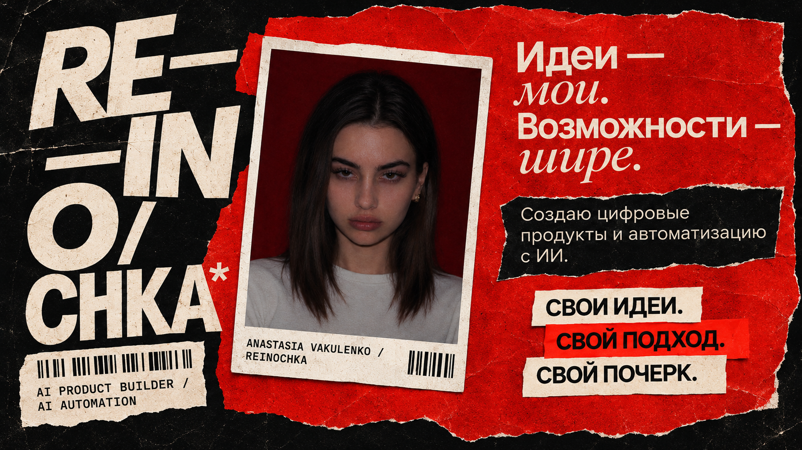
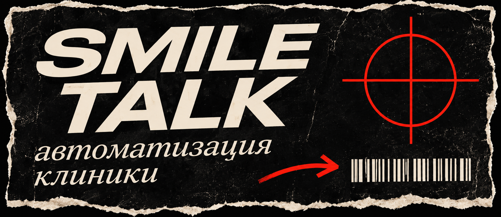
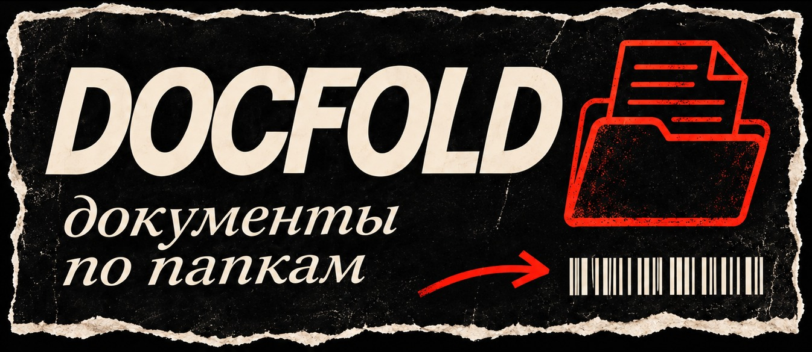
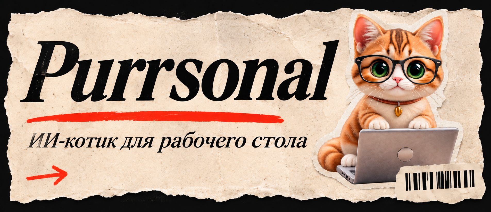
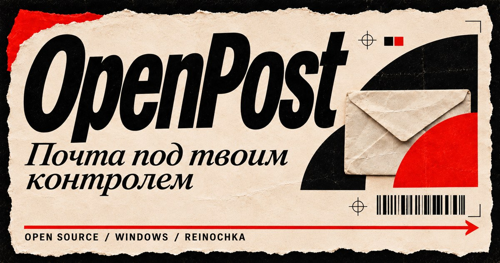
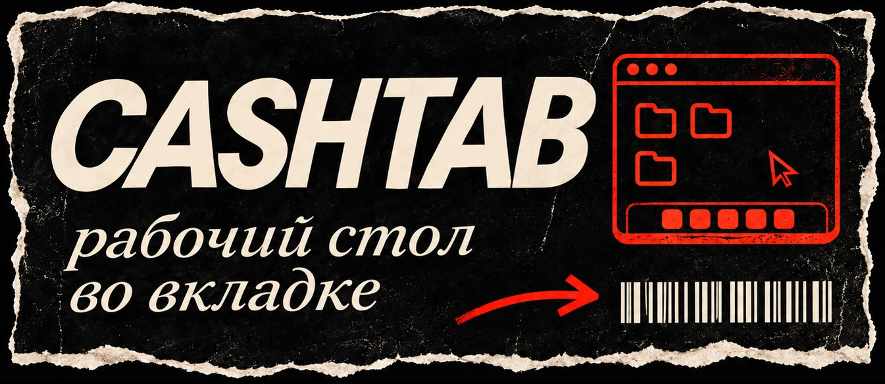
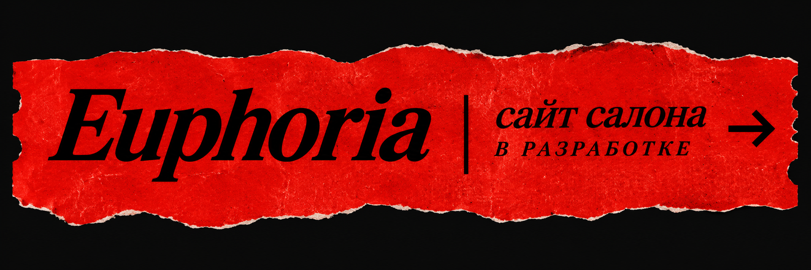
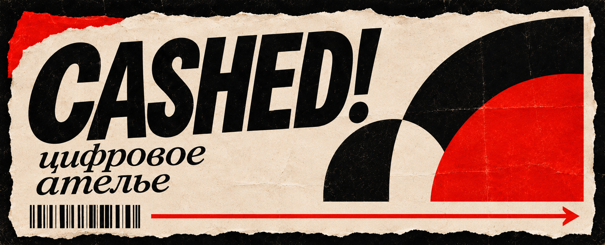
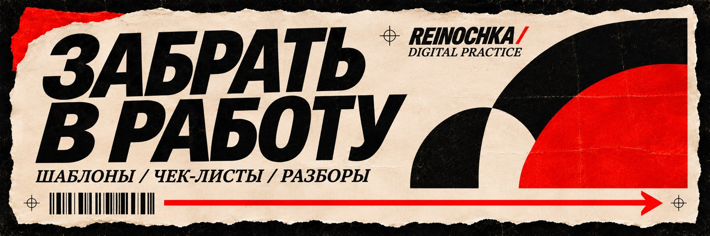

[RU](README.md) / **EN**

<a href="#selected-projects"><strong>EXPLORE PROJECTS ↗</strong></a> &nbsp; / &nbsp;
<a href="#behind-the-scenes"><strong>BEHIND THE SCENES ↗</strong></a> &nbsp; / &nbsp;
<a href="#say-hello"><strong>SAY HELLO ↗</strong></a>

**REINOCHKA / Anastasia Vakulenko**

**AI Automation Specialist | AI Product Builder**

I turn everyday work into digital products: CRM systems, Telegram bots, integrations and desktop applications. I define user flows, coordinate AI-assisted implementation, check behavior and refine the result.

Explore a system introduced in a clinic, open-source desktop tools and the decisions behind them.

[Quick portfolio guide →](en/START-HERE.md) · [Clinic system →](en/cases/smile-talk.md) · [Try DocFold →](https://github.com/r3in04ka-prog/docfold/releases/tag/v0.1.0)

## At a glance

| Task | Project | Explore |
|---|---|---|
| Team workflow automation | **SMILE TALK** | [Clinic workflows and rollout](en/cases/smile-talk.md) |
| Document processing | **DocFold** | [Decisions, interface and first release](en/cases/docfold.md) |
| An AI application | **Purrsonal** | [Key-free demo and product story](en/cases/purrsonal.md) |
| A desktop email client | **OpenPost** | [Demo and release boundaries](en/cases/openpost.md) |

## Selected projects

### 01 / SMILE TALK
**A clinic system that grew out of an administrator's daily work.**

CRM, two Telegram bots, Dental Pro integration, daily reports and a DeepSeek assistant. Problems I knew firsthand became the starting point for a product.

I identified team needs, designed the solution, coordinated implementation with AI, tested workflows and introduced the system.

**Introduced in September 2026.** I have not independently verified current operation since leaving the clinic. No quantified impact measurements were taken. The public case contains interfaces without current patient data.

[Story and workflows →](en/cases/smile-talk.md)

### 02 / DocFold
**Documents in folders. Review first, organize second.**

A local Windows tool for PDFs and scans: extract text, review suggested names and folders, then export copies with a register. No account or external API.

The focus is the complete file-processing flow: Russian and English OCR, exact duplicate detection, manual corrections and keeping originals unchanged.

**Try it:** built-in fictional sample documents. First release 0.1.0; OCR and suggested document details need human review.

[Download](https://github.com/r3in04ka-prog/docfold/releases/tag/v0.1.0) · [Product case](en/cases/docfold.md) · [Source and English guide](https://github.com/r3in04ka-prog/docfold/blob/main/README.en.md)

### 03 / Purrsonal
**A little kitten, a bigger idea for personal AI.**

A desktop companion with configurable personality, chat with your chosen model and persistent reminders. From a character concept to an open application you can install and make your own.

I defined the concept, behavior and first-version scope, coordinated AI-assisted implementation and checked user flows.

**Try it:** an offline demo without a model or key. Demo replies are scripted; real conversations require your own model. Early test release 0.2.0.

[Download for Windows](https://github.com/r3in04ka-prog/purrsonal/releases/tag/v0.2.0) · [Story and demo](en/cases/purrsonal.md) · [Source](https://github.com/r3in04ka-prog/purrsonal)

### 04 / OpenPost
**Your mail, in your own window.**

A Python desktop email client: inbox, reading, search, sending and replies over IMAP/SMTP. The interface and background network operations follow everyday email workflows.

**Try it:** a synthetic demo mailbox without connecting personal email. Early single-account version; OAuth and attachments are not implemented. Real delivery needs checking with your provider.

[Download](https://github.com/r3in04ka-prog/openpost/releases/latest) · [Story and demo](en/cases/openpost.md) · [Source](https://github.com/r3in04ka-prog/openpost)

## More from my world

### CashTab / A desktop inside a tab

A dock, links, notes and custom wallpaper: a small personal space in Chrome. Settings stay local. Distributed through GitHub and installed in developer mode.

[Explore and install →](https://github.com/r3in04ka-prog/CashTab)

### Euphoria / From discovery to booking

A salon website and customer journey: service → specialist → time → contact details. A work in progress exploring service presentation and booking logic.

**In development:** the complete booking and handling flow still needs completion and verification.

[Current state and case →](en/cases/euphoria.md)

### CASHED! / A separate brand, its own story

My digital brand with its own concept, visual identity and website. REINOCHKA is my professional profile; CASHED! develops separately.

**At launch stage.** Website availability and readiness are documented in the case.

[The CASHED! story →](en/cases/cashed.md) · [More visual work →](en/PORTFOLIO.md)

## Behind the scenes

Idea → user flow → AI-assisted implementation → checking → refinement.

I use ChatGPT, Claude and OpenAI Codex for technical implementation. My responsibility covers problem definition, product decisions, user flows and checking the resulting behavior. The materials distinguish implemented features, plans and unverified behavior.

**Implementation notes:** [A demo without a model or key](en/notes/offline-demo.md) / [Email client boundaries](en/notes/mail-boundaries.md)

[Product brief](en/templates/product-brief.md) · [Automation map](en/templates/automation-map.md) · [Demo checklist](en/templates/demo-checklist.md) · [Release card](en/templates/release-card.md)

[All resources →](en/USEFUL.md)

Original artwork and recorded application interfaces are in Russian.

## Say hello

Open to full-time work in AI Product Building and workflow automation: internal tools, CRM systems, bots and integrations. Also happy to discuss my projects.

Novosibirsk · remote or office · open to relocation

[Telegram ↗](https://t.me/r3in04ka) · [Email ↗](mailto:r3in04ka@gmail.com) · [Working with me](en/WORK-WITH-ME.md)
