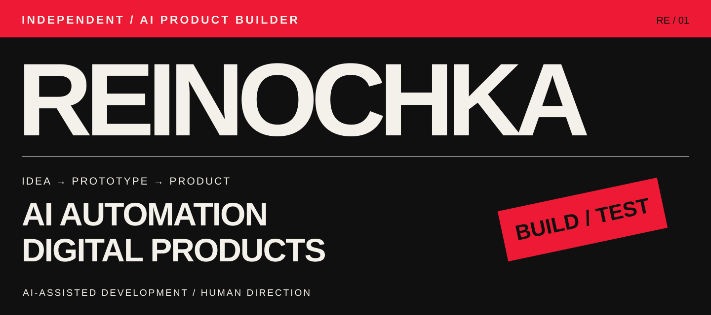

# REINOCHKA
**Анастасия Вакуленко · AI Automation Specialist / AI Product Builder**

Проектирую цифровые продукты и автоматизирую бизнес-процессы: от задачи и пользовательских сценариев до тестирования и внедрения. Техническую реализацию организую с помощью **ChatGPT, Claude и OpenAI Codex**.

[Telegram](https://t.me/r3in04ka) · [Email](mailto:r3in04ka@gmail.com) · [Kwork](https://kwork.ru/user/reino4ka)

Новосибирск · Рассматриваю удалённую и офисную работу, готова к переезду.

---

## 01 / SMILE TALK
**Автоматизация медицинской клиники · внедрён**

**Задача:** уменьшить ошибки и забытые действия администраторов, улучшить запись и отчётность.

**Решение:** CRM, два Telegram-бота, автоматический обмен с Dental Pro и AI-агент на базе DeepSeek. Внедрено в сентябре 2026 года.

**Моя роль:** концепция, требования, интерфейсы, организация AI-assisted разработки, тестирование и внедрение.

[Читать кейс: задача, решение и результат ↗](cases/smile-talk.md)

Исходники и внутренняя документация закрыты. Данные пациентов и конфиденциальные материалы здесь не публикуются.

## 02 / CASHED
**Independent Digital Atelier · запуск собственного бренда**

Самостоятельно создала бренд, визуальный стиль и сайт с помощью инструментов OpenAI. Готовы каталог услуг и форма заявки в Telegram. Направление Ready to Run — в разработке.

[Читать кейс CASHED ↗](cases/cashed.md) · [Посмотреть сайт ↗](https://cashed.dydns.io/)

## 03 / ЭЙФОРИЯ
**Платформа записи для салона красоты · в разработке**

Разрабатываю сайт салона «ЭЙФОРИЯ» с помощью инструментов OpenAI. В текущей версии доступны каталог услуг, разделы мастеров и начало онлайн-записи. Сайт и полный сценарий записи ещё в разработке.

[Читать кейс ЭЙФОРИЯ ↗](cases/euphoria.md) · [Текущая версия сайта ↗](https://app-61b54469.base44.app)

---

## Практика и инструменты

- **Продукт:** анализ задачи, требования, пользовательские сценарии и прототипирование.
- **Реализация с ИИ:** веб-приложения, Telegram-боты и Mini Apps, CRM, API-интеграции.
- **Внедрение:** тестирование и развёртывание на VPS с помощью AI-инструментов.

Моя сильная сторона — проектирование продукта и организация его реализации с ИИ. Конкретный технический стек указываю в документации проектов после проверки.

**Сейчас:** развиваю CASHED и ЭЙФОРИЮ, ищу работу в AI Automation и AI Product Building.

[Обсудить работу или проект →](https://t.me/r3in04ka)
