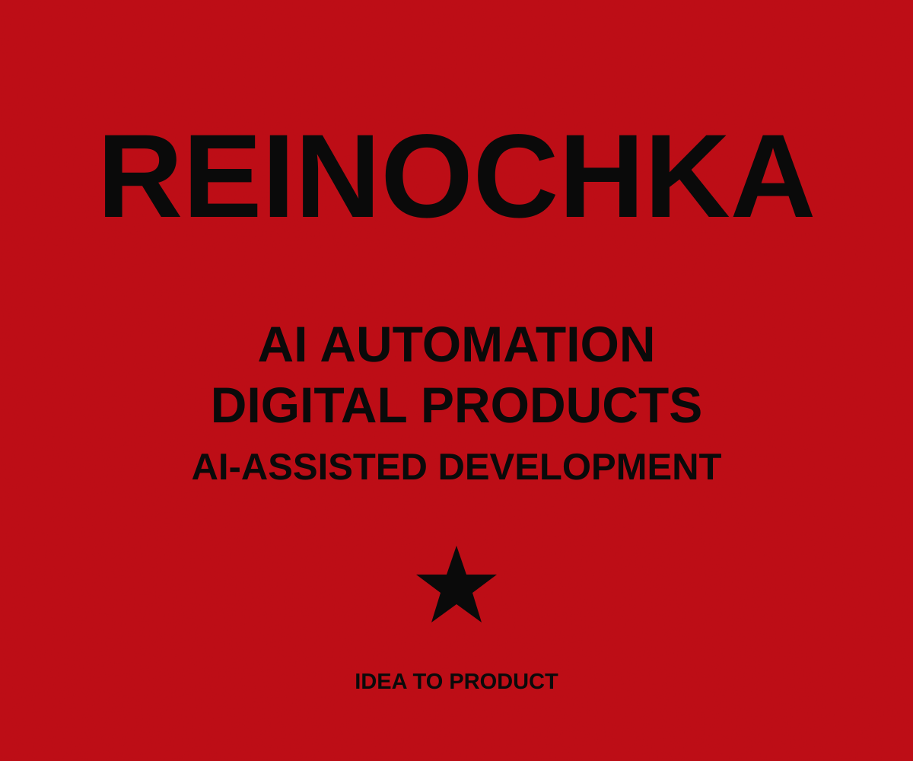

# REINOCHKA

**AI AUTOMATION / DIGITAL PRODUCTS / AI-ASSISTED DEVELOPMENT**

Создаю цифровые продукты и автоматизирую бизнес-процессы с помощью ИИ: от анализа задачи и проектирования интерфейсов до тестирования и внедрения.

[Telegram](https://t.me/r3in04ka) · [Email](mailto:r3in04ka@gmail.com) · [Kwork](https://kwork.ru/user/reino4ka)

## ABOUT

Я — Анастасия Вакуленко, **AI Automation Specialist | AI Product Builder**. Полное имя: Вакуленко Анастасия Максимовна.

Моя сильная сторона — самостоятельное проектирование продукта и организация его технической реализации с помощью ChatGPT, Claude и OpenAI Codex. Определяю пользовательские сценарии, формулирую требования, работаю над интерфейсами, проверяю результат и довожу решение до внедрения.

Новосибирск, Россия. Открыта к удалённой работе, офисному формату и переезду.

## WHAT I BUILD

- **Веб-приложения** — пользовательские интерфейсы и цифровые сервисы.
- **Telegram-боты и Mini Apps** — инструменты для клиентов и команд.
- **CRM и автоматизация** — рабочие процессы и взаимодействие сотрудников.
- **API-интеграции и AI-ассистенты** — связь сервисов и подключение AI-моделей.
- **Прототипы и внедрение** — проверка сценариев, тестирование и развёртывание на VPS с помощью AI-инструментов.

## SELECTED PROJECTS

### 01 / SMILE TALK
**Healthcare Automation Platform · внедрённый проект**

Проект комплексной автоматизации медицинской клиники. Система внедрена и продолжает использоваться сотрудниками.

Моя роль — проектирование концепции, функциональности и интерфейсов, организация AI-assisted разработки, тестирование и внедрение.

Исходный код и внутренняя документация закрыты. Подробный публичный кейс готовится отдельно.

### 02 / CASHED
**Independent Digital Atelier · самостоятельный бренд**

Мой отдельный предпринимательский проект в области цифровых продуктов: веб-приложений, Telegram-ботов, CRM и AI-решений.

REINOCHKA — мой профессиональный профиль. CASHED — отдельный цифровой бренд со своей визуальной идентичностью.

[Сайт CASHED ↗](https://cashed.dydns.io/)

### 03 / ЭЙФОРИЯ
**Beauty Booking Platform · в разработке**

Веб-приложение для салона красоты. Планируемые возможности: онлайн-запись, личный кабинет клиента, расписание, уведомления и административная панель.

Сейчас работаю над продуктом. Публичной демонстрации завершённой системы пока нет.

## TOOLS & WORKFLOW

**ChatGPT · Claude · OpenAI Codex · DeepSeek**

Использую AI-инструменты для анализа, проектирования и технической реализации. DeepSeek — для AI-ассистента в проекте автоматизации клиники.

Работаю с API-интеграциями, Telegram-ботами и Mini Apps; развёртываю приложения на VPS при помощи AI-инструментов. Конкретный стек выбираю под задачу и указываю в документации проектов после проверки.

**Мой процесс:** анализ задачи → требования и сценарии → прототип → AI-assisted разработка → тестирование → внедрение и обратная связь.

## CONTACTS

- **Telegram:** [@r3in04ka](https://t.me/r3in04ka)
- **Email:** [r3in04ka@gmail.com](mailto:r3in04ka@gmail.com)
- **Kwork:** [reino4ka](https://kwork.ru/user/reino4ka)

## CURRENT FOCUS

Развиваю AI-продукты, работаю над платформой записи ЭЙФОРИЯ и отдельным брендом CASHED. Ищу постоянную работу в IT и профессиональные возможности в AI Automation и AI Product Building, где смогу проектировать полезные решения и доводить их до практического использования.

