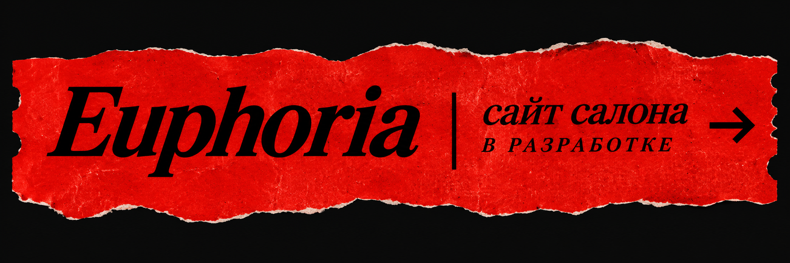
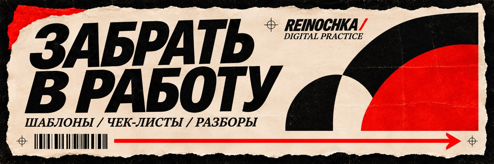

**RU** / [EN](README.en.md)

  <a href="#избранное"><strong>СМОТРЕТЬ ПРОЕКТЫ ↗</strong></a>
  &nbsp; / &nbsp;
  <a href="#за-кулисами"><strong>ЗА КУЛИСАМИ ↗</strong></a>
  &nbsp; / &nbsp;
  <a href="#на-связи"><strong>НА СВЯЗИ ↗</strong></a>

**REINOCHKA / Анастасия Вакуленко**

**AI Automation Specialist | AI Product Builder**

Превращаю рабочие задачи в цифровые продукты: CRM, Telegram-ботов, интеграции и собственные приложения. Продумываю сценарии, собираю решения с ИИ, проверяю и дорабатываю.

Здесь — система, внедрённая в клинике, открытые desktop-инструменты и истории их создания.

[Быстрый обзор портфолио →](START-HERE.md) · [Система для клиники →](cases/smile-talk.md) · [Попробовать DocFold →](https://github.com/r3in04ka-prog/docfold/releases/tag/v0.1.0)

## За минуту

| Задача | Проект | Что посмотреть |
|---|---|---|
| Автоматизация работы команды | **SMILE TALK** | [Сценарии и внедрение в клинике](cases/smile-talk.md) |
| Обработка документов | **DocFold** | [Решения, интерфейс и первая версия](cases/docfold.md) |
| Приложение с ИИ | **Purrsonal** | [Демо без ключа и история продукта](cases/purrsonal.md) |
| Почтовый клиент | **OpenPost** | [Демонстрация и границы версии](cases/openpost.md) |

## Избранное

### 01 / SMILE TALK
**Из рабочих задач — в систему для клиники.**

CRM, два Telegram-бота, обмен с Dental Pro, ежедневные сводки и AI-помощник. Задачи, которые я знала изнутри, стали отправной точкой для продукта.

Я выявила потребности команды, спроектировала решение, организовала разработку с ИИ, проверяла сценарии и внедряла систему.

**Внедрение:** сентябрь 2026. Текущую эксплуатацию после моего ухода независимо не проверяю; количественных замеров эффекта не было. В публичном кейсе — интерфейсы без актуальных данных пациентов.

[История проекта и рабочие сценарии →](cases/smile-talk.md)

### 02 / DocFold
**PDF и сканы — в проверенные документы по папкам.**

Локальный инструмент для PDF и сканов: извлечь текст, проверить предложенные имена и папки, сохранить копии с реестром. Без аккаунта и внешнего API.

Здесь главное — путь от пачки файлов до проверенного результата: OCR на русском и английском, поиск точных дублей, ручные исправления и сохранение оригиналов без изменений.

**Попробовать:** встроенный пример с вымышленными документами. Первая версия 0.1.0; распознавание и предложенные реквизиты требуют проверки пользователем.

[Скачать для Windows](https://github.com/r3in04ka-prog/docfold/releases/tag/v0.1.0) · [Разбор продукта](cases/docfold.md) · [Код](https://github.com/r3in04ka-prog/docfold)

### 03 / Purrsonal
**Маленький котик, большая идея персонального ИИ.**

Котик поверх окон, свой характер, чат с выбранной моделью и напоминания. От идеи персонажа — к открытому приложению, которое можно установить и настроить для себя.

Я определила концепцию, поведение и функции первой версии, организовала реализацию с ИИ и проверку сценариев.

**Попробовать:** демо без модели и ключа. Ответы в нём подготовлены заранее; для настоящего чата нужна своя модель. Тестовая версия 0.2.0.

[Скачать для Windows](https://github.com/r3in04ka-prog/purrsonal/releases/tag/v0.2.0) · [История и демонстрация](cases/purrsonal.md) · [Код](https://github.com/r3in04ka-prog/purrsonal)

### 04 / OpenPost
**Своя почта в своём окне.**

Настольный почтовый клиент на Python: входящие, чтение, поиск, отправка и ответы через IMAP/SMTP. Интерфейс и фоновые сетевые операции собраны вокруг повседневного сценария работы с письмами.

**Попробовать:** демонстрационный ящик без подключения личной почты. Ранняя версия для одного аккаунта; OAuth и вложений пока нет. Реальную доставку нужно проверять с выбранным провайдером.

[Скачать для Windows](https://github.com/r3in04ka-prog/openpost/releases/latest) · [История и демонстрация](cases/openpost.md) · [Код](https://github.com/r3in04ka-prog/openpost)

## Ещё из моего мира

### Euphoria / От знакомства до записи

Сайт салона и путь клиента: услуга → мастер → время → контакты. Работа над представлением услуг и логикой записи.

**В разработке:** полный путь создания и обработки записи ещё предстоит завершить и проверить.

[Посмотреть текущую версию и кейс →](cases/euphoria.md)

### CASHED! / Отдельный бренд, отдельная история

Мой цифровой бренд со своей концепцией, визуальным языком и сайтом. REINOCHKA — мой профессиональный профиль; CASHED! развивается отдельно.

**На этапе запуска.** Статус доступности сайта и границы готовности отмечены в кейсе.

[История CASHED! →](cases/cashed.md) · [Другие визуальные работы →](PORTFOLIO.md)

### CashTab / Рабочий стол внутри вкладки

Док, ссылки, заметки и свои обои — маленькое личное пространство в Chrome. Настройки хранятся локально. Расширение распространяется через GitHub и устанавливается в режиме разработчика.

[Посмотреть и установить →](https://github.com/r3in04ka-prog/CashTab)

## За кулисами

Идея → сценарий → реализация с ИИ → проверка → доработка.

Использую ChatGPT, Claude и OpenAI Codex для технической реализации. Моя работа — постановка задачи, продуктовые решения, пользовательские сценарии и проверка поведения результата. В материалах отделяю работающие функции от планов и того, что ещё требует проверки.

**Разборы решений:** [Демо без модели и ключа](notes/offline-demo.md) / [Границы почтового клиента](notes/mail-boundaries.md)

[Бриф продукта](templates/product-brief.md) · [Карта автоматизации](templates/automation-map.md) · [Проверка демо](templates/demo-checklist.md) · [Карточка релиза](templates/release-card.md)

[Все материалы →](USEFUL.md) · [Подробнее об опыте →](ABOUT.md)

## На связи

Открыта к постоянной работе в AI Product Building и автоматизации: внутренние сервисы, CRM, боты и интеграции. Также рада обсуждению моих проектов.

Новосибирск · удалённо или в офисе · готова к переезду

[Telegram ↗](https://t.me/r3in04ka) · [Email ↗](mailto:r3in04ka@gmail.com) · [Подробнее о работе со мной](WORK-WITH-ME.md)
