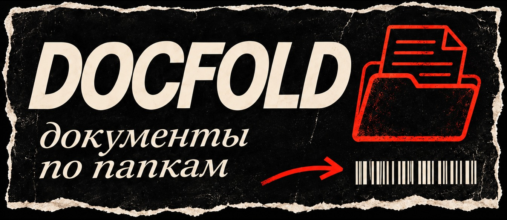

**RU** / [EN](../en/cases/docfold.md) · [← Профиль](../README.md)

# DocFold / От пачки сканов до документов по папкам

**Локальное приложение для Windows. Первая версия 0.1.0.**

[Скачать для Windows x64](https://github.com/r3in04ka-prog/docfold/releases/tag/v0.1.0) · [Исходный код и инструкция](https://github.com/r3in04ka-prog/docfold)

## Задача

Пачка PDF и сканов требует ручной работы: открыть каждый файл, прочитать содержимое, придумать имя и выбрать папку. DocFold собирает эти действия в один сценарий с проверкой перед сохранением.

## Пользовательский путь

1. Добавить PDF или изображения — либо открыть встроенный пример.
2. Извлечь текст из PDF; для сканов использовать локальное OCR на русском и английском.
3. Проверить первый лист, распознанный текст, предложенные дату, имя и папку. Исправить предложения или исключить документ.
4. Сохранить копии по папкам вместе с текстами и общим CSV-реестром.

## Продуктовые решения

| Решение | Зачем оно нужно |
|---|---|
| Локальная обработка без аккаунта и внешнего API | Начать работу без регистрации и отправки документов внешней модели |
| Проверка перед экспортом | Пользователь видит и исправляет ошибки распознавания и правил |
| Копии вместо изменения оригиналов | Результат можно проверить, сохранив исходные файлы |
| Поиск точных дублей по SHA-256 | Не обрабатывать повторные копии одного файла |
| Реестр с исходными именами и способами извлечения | Сопоставлять результат с исходниками |
| Вымышленные документы во встроенном примере | Проверить основной сценарий до добавления собственных файлов |

## Что реализовано

Извлечение текстового слоя PDF, OCR сканов, предложения папки и имени по простым правилам, ручные исправления, пропуск точных дублей и экспорт копий без перезаписи существующих файлов. Изменение исходника после анализа останавливает его экспорт.

Техническая основа: Electron, PDF.js и Tesseract.js. OCR-модели входят в приложение; обработка документов работает без интернета.

## Статус и проверка

Опубликована первая версия 0.1.0. В репозитории описаны автоматические проверки обработки файлов и экспорта, а также smoke-проверка интерфейса со встроенным примером.

**Ограничения:** до 30 файлов в сессии, 40 МБ на файл и 30 страниц в PDF. OCR, тип и дата требуют проверки. Рукопись и сложные таблицы не являются надёжным сценарием; DOCX, XLSX, электронные подписи и добавление поискового слоя в PDF не реализованы.

Количественные данные об экономии времени и независимые результаты внедрения не публиковались.

## Что дальше

В плане проекта: поворот и выбор области OCR, выбор языка и страниц, поиск по результатам, редактирование текста и предложение реквизитов с явной проверкой. Эти функции не входят в заявленную готовность версии 0.1.0.

[Попробовать DocFold →](https://github.com/r3in04ka-prog/docfold/releases/tag/v0.1.0) · [Другие проекты →](../README.md#избранное)
