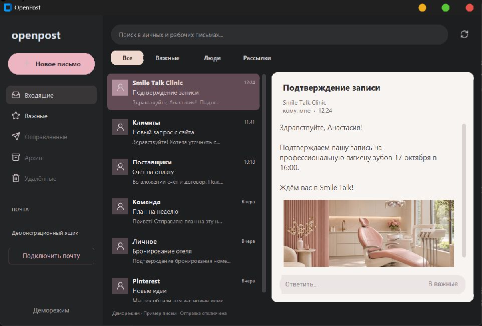
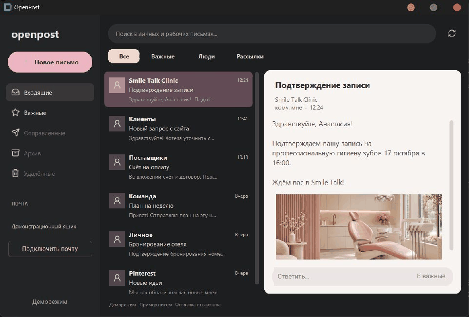

**RU** / [EN](../en/cases/openpost.md)

[← REINOCHKA](../README.md)

# OpenPost

**Открытый почтовый клиент для Windows · версия 0.2.2**

Личный проект настольного почтового клиента: три колонки, тёмный интерфейс с розовыми акцентами и светлая область чтения.

[Скачать для Windows →](https://github.com/r3in04ka-prog/openpost/releases/latest) · [Исходный код →](https://github.com/r3in04ka-prog/openpost)

## Задача и моя роль

Создать понятный почтовый клиент, который работает с почтовым сервером пользователя и не требует общего аккаунта приложения. Моя роль — продуктовые решения, визуальное направление и организация реализации с помощью ИИ.

## Что работает

- Загрузка последних 50 писем через IMAP и чтение текстовой части.
- Поиск по загруженным отправителям, темам и содержимому.
- Создание письма и ответ через SMTP.
- Локальные отметки важных писем и фильтры списка.
- Деморежим без подключения аккаунта, с вымышленными письмами и отключённой отправкой.

## Демонстрация

*Записан работающий интерфейс с синтетическими данными. Личная почта не подключалась, реальные сообщения не отправлялись.*

## Техническая основа и ограничения

Python, CustomTkinter и Pillow. Почта подключается по IMAP/SMTP с проверкой TLS-сертификата и имени сервера. Пароль и письма хранятся в памяти процесса; отдельное дисковое хранилище переписки не реализовано.

Поддерживается один аккаунт. Вложения, OAuth, несколько аккаунтов, другие папки, удаление и офлайн-хранилище пока не реализованы. Демонстрационная картинка в письме входит в приложение; внешние изображения из реальных писем не загружаются.

Автоматические проверки используют имитацию серверов. Реальная доставка требует отдельной проверки с аккаунтом пользователя. Это начальная версия, а не замена полноценному почтовому клиенту для всех сценариев.

[Установка, настройка и ограничения →](https://github.com/r3in04ka-prog/openpost#readme)
