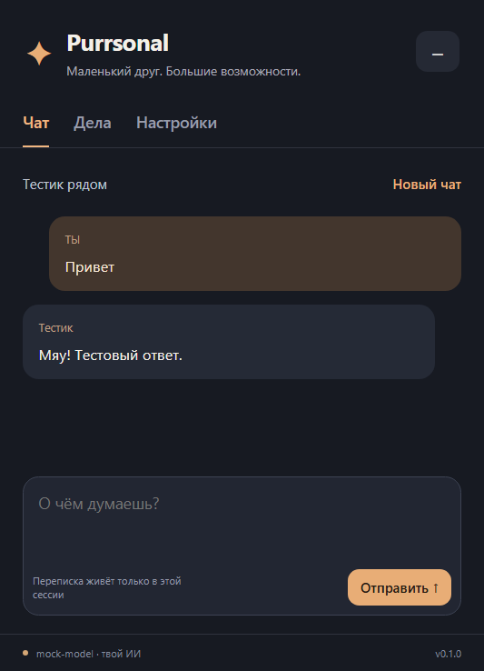
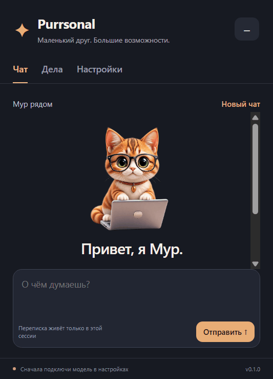

[← REINOCHKA](../README.md)

# Purrsonal

**Открытый ИИ-помощник для Windows · первая тестовая версия**

Котик живёт поверх окон, открывает чат по нажатию и подключается к выбранной пользователем модели ИИ.

*Скриншот работающего приложения во время проверки. Ответ и имя котика тестовые: это проверка интерфейса и подключения, а не демонстрация качества конкретной модели.*

[Скачать для Windows →](https://github.com/r3in04ka-prog/purrsonal/releases/tag/v0.1.0) · [Исходный код и инструкция →](https://github.com/r3in04ka-prog/purrsonal)

## Демонстрация

*Записан настоящий интерфейс с отдельными временными настройками и тестовым локальным сервером. Ответ не получен от внешней модели. Личные ключи и переписка не использовались.*

## Задача и моя роль

Превратить идею персонального ИИ-питомца в приложение, которое каждый может скачать и настроить для себя. Я выбрала персонажа и поведение, определила функции первой версии и организовала реализацию с помощью ИИ.

## Что работает

- Прозрачный котик поверх окон с перетаскиванием и лёгкой анимацией.
- Чат с выбранным сервером модели, включая локальную Ollama.
- Собственные имя, характер, размер и настройки автозапуска.
- Запуск выбранных программ через кнопки с подтверждением.
- Напоминания, сохраняемые между запусками.

## Проверка и ограничения

Приложение проверялось с тестовым локальным сервером: создание окон, обмен сообщениями, шифрование ключа, обработка текста напоминаний и прозрачность изображения. Репозиторий содержит проверки и сборку Windows в GitHub Actions.

Это ранняя версия. Голос, просмотр экрана и автономное управление компьютером ещё не реализованы. Модель пользователь подключает самостоятельно. Установщик не подписан цифровой подписью.

## Открытый проект

Код опубликован под MIT. Настройки и ключи пользователей не входят в репозиторий. Идеи и изменения можно предложить через issues и pull requests.
