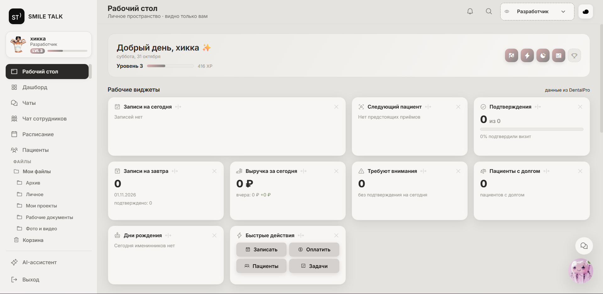
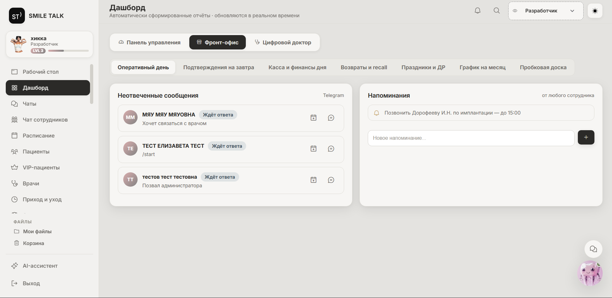
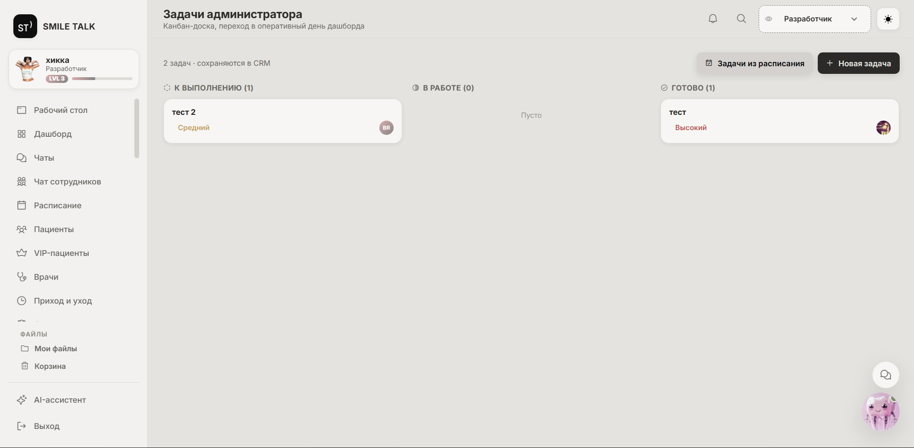
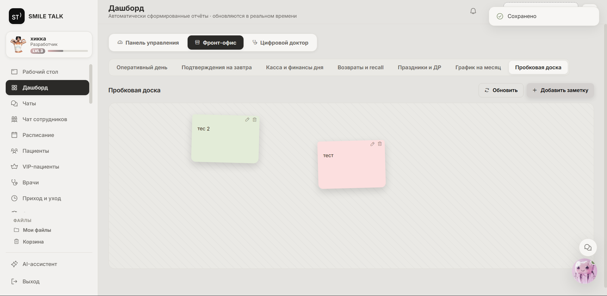
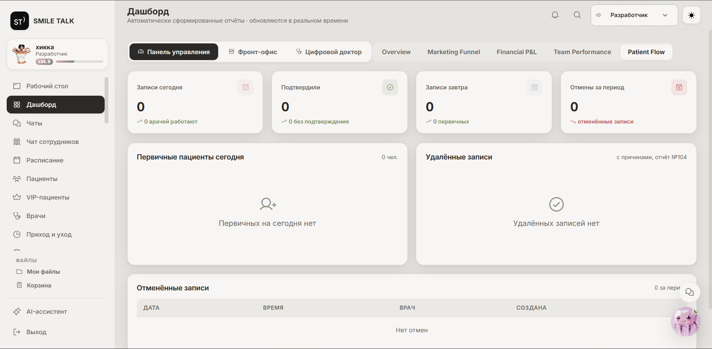

[← REINOCHKA](../README.md)

# 01 / SMILE TALK
**Автоматизация медицинской клиники · CRM + Telegram + AI**

От рабочих задач администратора — к системе записи, напоминаний и ежедневной отчётности.

| | |
|---|---|
| Автор | Анастасия Вакуленко / REINOCHKA |
| Роль | Проектирование продукта, организация разработки с ИИ, тестирование и внедрение |
| Внедрение | Сентябрь 2026 |
| Пользователи при внедрении | Два администратора, руководитель и главный врач |
| Формат | Закрытый рабочий проект; публичное описание без исходников и данных пациентов |

## Задача

Снизить количество ошибок и забытых действий у администраторов, улучшить запись пациентов, собрать напоминания, заметки и задачи в понятный рабочий процесс. Отчёты для руководства до внедрения собирались вручную.

Работая администратором клиники, я самостоятельно определила потребности, спроектировала решение и организовала его техническую реализацию с помощью ChatGPT, Claude и OpenAI Codex. Проверяла сценарии и внедряла систему в работу команды.

## Решение

### CRM — рабочее место администратора

Рабочий стол с оперативными виджетами, расписание, поиск пациентов, касса, задачи и заметки. В интерфейсе также предусмотрены переписки, сводки по записям, отмены и переносы, отчёты и обратная связь.

Задачи представлены по статусам «К выполнению», «В работе», «Готово»; общая доска заметок помогает передавать информацию между сотрудниками.

### Telegram-бот для пациентов

Пациент может записаться, посмотреть свою запись, получить напоминание, отменить визит или задать вопрос. Переписка доступна администратору в CRM.

### Telegram-бот для администраторов

- Утренний дайджест и напоминания о рабочих действиях.
- Ежедневный автоматический отчёт в общую беседу в **19:30**.
- Уведомления об отзывах из 2ГИС.
- Список задач с кнопками выполнения: закрытие в Telegram отражается в CRM.

Сводка включает плановые записи, фактические посещения, отмены, отзывы, ожидающие обработки, и незакрытые задачи прошлых дней.

### Интеграция с Dental Pro

Автоматический двусторонний обмен между CRM и медицинской информационной системой: пациенты, расписание, кассовые данные и связанные рабочие сведения. Описание обмена основано на моём опыте реализации и эксплуатации проекта; публичный кейс не является проверкой каждого метода интеграции.

### AI-агент на базе DeepSeek

Помогает администраторам получать рабочую информацию естественным языком. Например, на вопрос **«Кто завтра работает?»** сообщает врачей и их график на следующий день.

## Три рабочих сценария

| Ситуация | Как помогает система |
|---|---|
| Администратору нужно не забыть действие | Задача остаётся в списке; её можно закрыть кнопкой в Telegram с отражением в CRM |
| Руководству нужна сводка за день | Отчёт автоматически приходит в общую беседу в 19:30 |
| Нужно узнать завтрашний график врачей | Администратор задаёт вопрос AI-агенту и получает расписание |

## Результат внедрения

По моим наблюдениям во время работы в клинике, стало меньше забытых действий, а отчётность для руководства стала удобнее: вместо ручной подготовки появилась автоматическая ежедневная сводка.

Количественные замеры сокращения ошибок или экономии времени не проводились, поэтому проценты и финансовый эффект здесь не заявлены.

По имеющимся у меня сведениям, сотрудники продолжили пользоваться системой после моего увольнения. Доступа к свежим данным клиники у меня больше нет, текущую эксплуатацию я независимо не проверяю.

## Интерфейс

Скриншоты показывают интерфейс проекта. Во фронт-офисе используются вымышленные данные, на досках — тестовые записи. Экраны без актуальных данных МИС показывают пустые состояния; нулевые показатели не являются результатами работы клиники.

### Рабочий стол

Оперативные виджеты записей, подтверждений и быстрых действий.

### Фронт-офис

Неотвеченные сообщения и напоминания в одном окне. **Демонстрационные данные.**

### Задачи администратора

Канбан-доска со статусами «К выполнению», «В работе», «Готово» и приоритетами задач. На скриншоте — тестовые задачи.

### Общие заметки

Пробковая доска для передачи информации внутри команды. На скриншоте — тестовые заметки.

### Поток пациентов

Экран записей, подтверждений и отмен. Показано состояние без актуальных данных клиники.

## Границы демонстрации

При просмотре оставшегося интерфейса часть разделов открывается без свежих данных Dental Pro или сообщает о недоступности веб-кабинета. Нулевые показатели на таких экранах не отражают подтверждённые результаты работы клиники и не используются для оценки эффекта проекта.

Опубликованы описание и скриншоты с тестовыми или вымышленными записями и пустыми состояниями. Исходный код, внутренняя документация, рабочие адреса системы, реальные переписки и сведения о пациентах не публикуются.

---

[Обсудить проект →](https://t.me/r3in04ka) · [Профиль REINOCHKA](../README.md)
