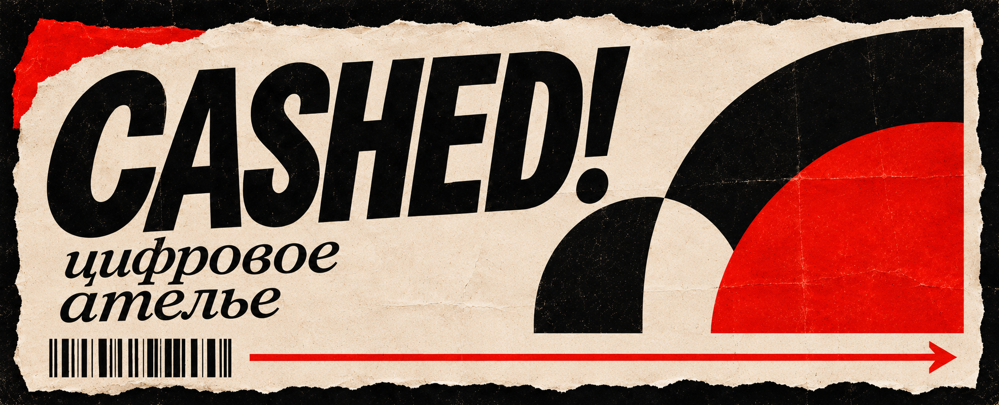

[RU](../../cases/cashed.md) / **EN** · [← Profile](../../README.en.md)

# 01 / CASHED!

**Independent digital atelier · my own brand, at launch stage**

A brand and website presenting digital-product services and an enquiry form.

[Website ↗](https://cashed.dydns.io/)

*Availability check on 16 November 2026: the website did not respond within the allotted time. This case documents the prepared version, not a fresh availability check.*

| | |
|---|---|
| Author | Anastasia Vakulenko / REINOCHKA |
| My role | Brand concept, visual identity and website creation using OpenAI tools |
| Prepared | Website, service catalogue and enquiry form |
| In development | Ready to Run offering |
| Status | Launching my own brand |

## Goal

Bring my services together under a distinct brand, explain my approach and give visitors a clear way to describe their project. REINOCHKA is my professional profile; CASHED! is a separate brand with its own identity.

## What I created

I developed the concept, design and website with OpenAI tools. The website combines an explanation of the approach, a service catalogue and an enquiry form.

- **Web:** websites and web applications.
- **Bots:** Telegram bots and Mini Apps.
- **Systems:** CRM, AI solutions and workflow automation.

These are service categories, not evidence of completed client commissions in every category.

The enquiry form asks for a name, email or Telegram contact, and a task description. I configured enquiries to arrive in my Telegram. Opening the form and its fields were checked; a test enquiry was not submitted during case preparation, so delivery was not independently verified.

## Ready to Run

The site presents directions for clinics, salons, shops, cafés and delivery services, studios and trainers. These foundations are **still in development**, not deployment-ready products.

## Current result

A distinct brand and a published website with a service catalogue and enquiry form were created. The brand is at launch stage. This case makes no claims about client orders, revenue, conversion or other commercial results.

The project demonstrates brand concept, visual direction, service structure and an enquiry journey. Implementation used OpenAI tools; unverified stack details and individual models are not listed.
