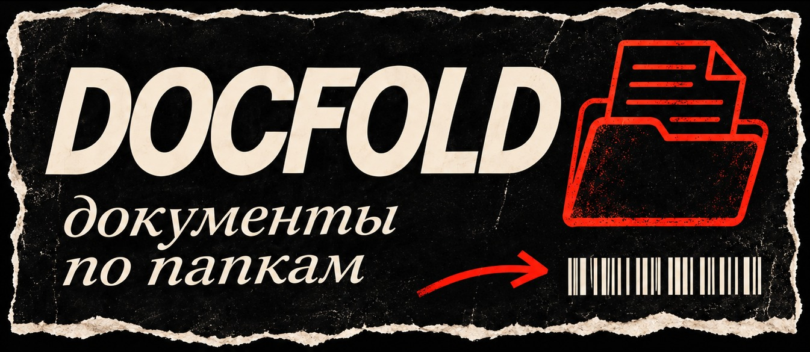

[RU](../../cases/docfold.md) / **EN** · [← Profile](../../README.en.md)

# DocFold / From a batch of scans to organized files

**A local Windows application. First release 0.1.0.**

[Download for Windows x64](https://github.com/r3in04ka-prog/docfold/releases/tag/v0.1.0) · [Source and English guide](https://github.com/r3in04ka-prog/docfold/blob/main/README.en.md)

## The problem

A batch of PDFs and scans means opening each file, reading it, choosing a name and finding a folder. DocFold brings these steps into one workflow with review before export.

## User journey

1. Add PDFs or images, or open the built-in sample.
2. Extract PDF text; run local Russian and English OCR on scans.
3. Review the first page, extracted text, suggested date, filename and folder. Correct suggestions or exclude a document.
4. Export copies into folders together with text files and a CSV register.

## Product decisions

| Decision | Purpose |
|---|---|
| Local processing without an account or external API | Start without registration or sending documents to an external model |
| Review before export | Let the user see and correct OCR and rule-based errors |
| Copies instead of changing originals | Keep source files available for comparison |
| Exact duplicate detection with SHA-256 | Skip repeated copies of the same file |
| A register with original names and extraction methods | Trace exported files back to their sources |
| Fictional built-in samples | Try the main workflow before adding personal documents |

## Implemented

PDF text extraction, scan OCR, rule-based folder and filename suggestions, manual corrections, exact duplicate detection and export without overwriting existing files. A source file changed after analysis cannot be exported until it is added again.

Built with Electron, PDF.js and Tesseract.js. OCR models are bundled; document processing works offline.

## Status and verification

First release 0.1.0 is published. The repository documents automated file-processing and export checks, plus an interface smoke check using the built-in sample.

**Boundaries:** up to 30 files per session, 40 MB per file and 30 pages per PDF. OCR, type and date suggestions require review. Handwriting and complex tables are not reliable workflows. DOCX, XLSX, electronic signatures and adding searchable PDF text layers are not implemented. The interface is in Russian.

No measured time savings or independent deployment results have been published.

## Next

The project plan includes OCR rotation and region selection, language and page controls, result search, text editing and document-detail suggestions with explicit review. These are plans beyond release 0.1.0.

[Try DocFold →](https://github.com/r3in04ka-prog/docfold/releases/tag/v0.1.0) · [Other projects →](../../README.en.md#selected-projects)
