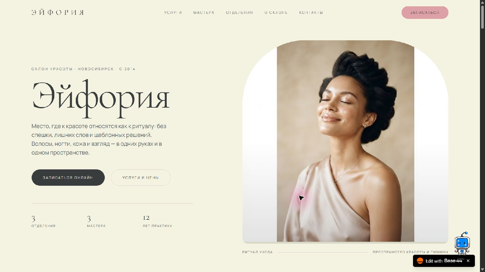

[RU](../../cases/euphoria.md) / **EN** · [← Profile](../../README.en.md)

# 02 / Euphoria

**Beauty salon website and online booking · in development**

A website for the Euphoria salon, helping visitors explore services and begin booking online.

*Captured on 16 November 2026. Numbers and claims visible on the demonstration page are not verified results of my work. The project remains in development.*

[Current website ↗](https://app-61b54469.base44.app)

| | |
|---|---|
| Author | Anastasia Vakulenko / REINOCHKA |
| Project | Website for the Euphoria beauty salon |
| Tools | Developed using OpenAI tools; current version hosted on Base44 |
| Status | In development; completed deployment is not claimed |

## Goal

Design the journey from discovering salon services to choosing a treatment and booking a suitable time.

## Current version

- Salon homepage.
- Service catalogue with prices and estimated durations.
- Team, locations, about and contact sections.
- Initial booking screen with service selection.

The interface outlines **service → specialist → time → contact details**. The homepage and opening step were checked. Creating a booking, delivering notifications and internal dashboards were not verified.

## My work and next steps

I am developing the website with OpenAI tools, focusing on service presentation and the booking journey. The full flow still needs completion and testing, including saving a request and handling it on the salon side. The catalogue also needs review: the current version contains repeated services with different prices.

Accounts, scheduling, notifications and administration are development directions; this case does not claim they are ready or used by customers.

## Current result

An intermediate website and initial booking interface are available. A completed rollout, real customer bookings and commercial outcomes are not claimed. Website content may change; its prices, reviews and salon claims are not evidence of my project outcomes.
