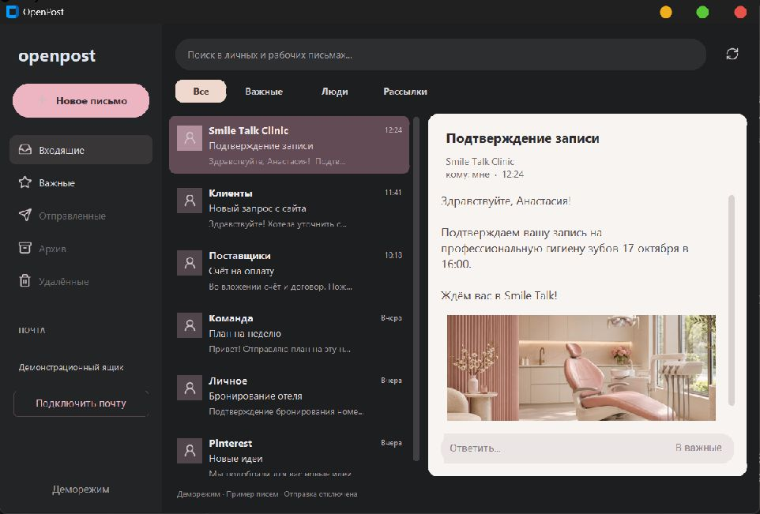
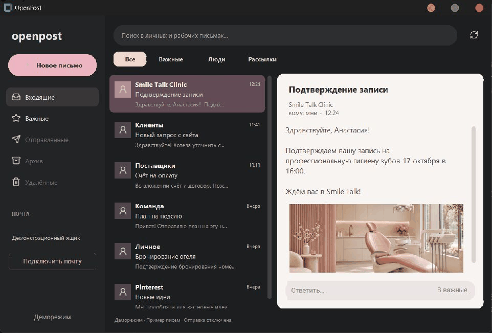

[RU](../../cases/openpost.md) / **EN** · [← Profile](../../README.en.md)

# OpenPost

**Open-source email client for Windows · version 0.2.2**

A personal desktop-email project with three columns, a dark interface, pink accents and a light reading pane.

[Download for Windows →](https://github.com/r3in04ka-prog/openpost/releases/latest) · [Source →](https://github.com/r3in04ka-prog/openpost)

## Goal and my role

Create a clear email client that connects to the user's mail server without requiring a separate application account. My role covers product decisions, visual direction and coordinating implementation with AI tools.

## Implemented

- Fetching the latest 50 emails through IMAP and reading their plain-text parts.
- Searching loaded senders, subjects and message content.
- Composing and replying through SMTP.
- Local important-message markers and list filters.
- An account-free demo mailbox with fictional messages and sending disabled.

## Demo

*Actual interface with synthetic data. No personal mailbox was connected and no real messages were sent. The recorded interface is in Russian. Use “Демо” (Demo) to try it.*

## Technical foundation and limitations

Python, CustomTkinter and Pillow. IMAP/SMTP connections verify TLS certificates and the server hostname. The password and messages live in process memory; a separate on-disk message archive is not implemented.

One account is supported. Attachments, OAuth, multiple accounts, other folders, deletion and offline storage are not implemented. The demo illustration is bundled with the app; external images from real emails are not loaded.

Automated checks use simulated servers. Real delivery requires a separate check with the user's account. This is an early version rather than a complete email client for every use case. Project setup instructions may be in Russian.

[Installation and limitations →](https://github.com/r3in04ka-prog/openpost#readme) · [Implementation note →](../notes/mail-boundaries.md)
