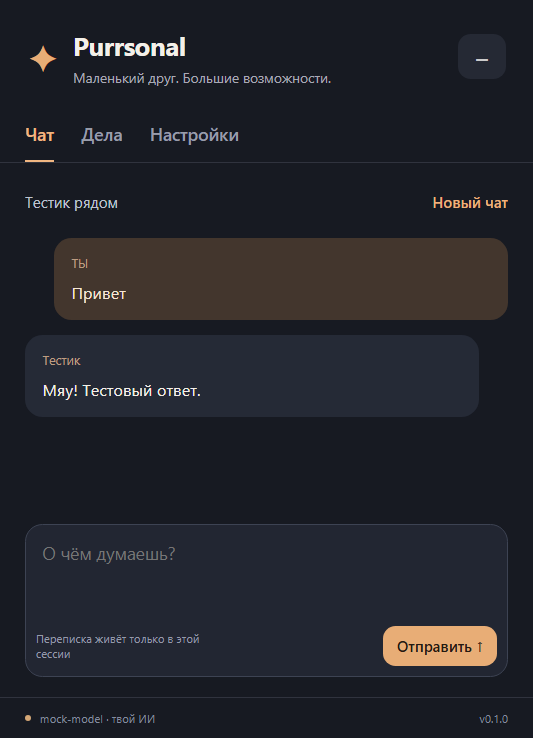
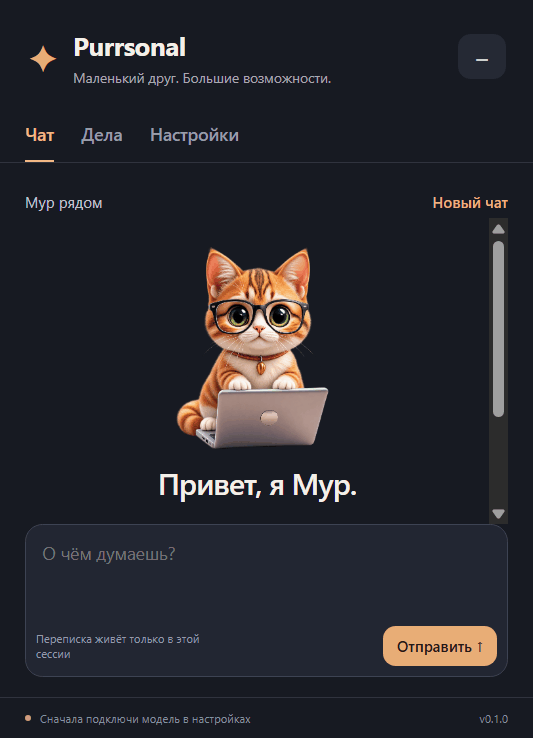

[RU](../../cases/purrsonal.md) / **EN** · [← Profile](../../README.en.md)

# Purrsonal

**Open-source Windows AI companion · early test release 0.2.0**

A kitten that stays above other windows, opens a chat when clicked and connects to a model chosen by the user.

Version 0.2.0 adds “Попробовать демо” (Try demo): scripted examples without a model, key or network connection. The demo is clearly labelled, preserves personal settings and does not substitute for real AI.

*Captured during an application check. The reply and kitten name are test content, demonstrating the interface and connection rather than model quality. The recorded interface is in Russian.*

[Download for Windows →](https://github.com/r3in04ka-prog/purrsonal/releases/tag/v0.2.0) · [Source and setup →](https://github.com/r3in04ka-prog/purrsonal)

## Demo

*Recorded with isolated temporary settings and a local test server. Replies did not come from an external model. No personal keys or conversations were used.*

## Goal and my role

Turn a personal AI-pet idea into an application that anyone can download and configure. I chose the character and behavior, defined the first-version features and coordinated implementation with AI tools.

## Implemented

- A draggable kitten in a transparent window, with light animation.
- Chat through a user-selected model server, including local Ollama.
- Custom name, personality, size and startup settings.
- Buttons to launch selected applications with confirmation.
- Reminders preserved between launches.

## Verification and limitations

Checks with a local test server covered window creation, messaging, key encryption, reminder text handling and image transparency. The repository includes checks and a Windows build workflow in GitHub Actions.

This is an early release. Voice, screen understanding and autonomous computer control are not implemented. Users connect their own model. The installer is not digitally signed. Project setup instructions may be in Russian.

## Open source

The code is MIT-licensed. User settings and keys are not part of the repository. Suggestions and contributions are welcome through issues and pull requests.

[Implementation note: an offline demo →](../notes/offline-demo.md)
