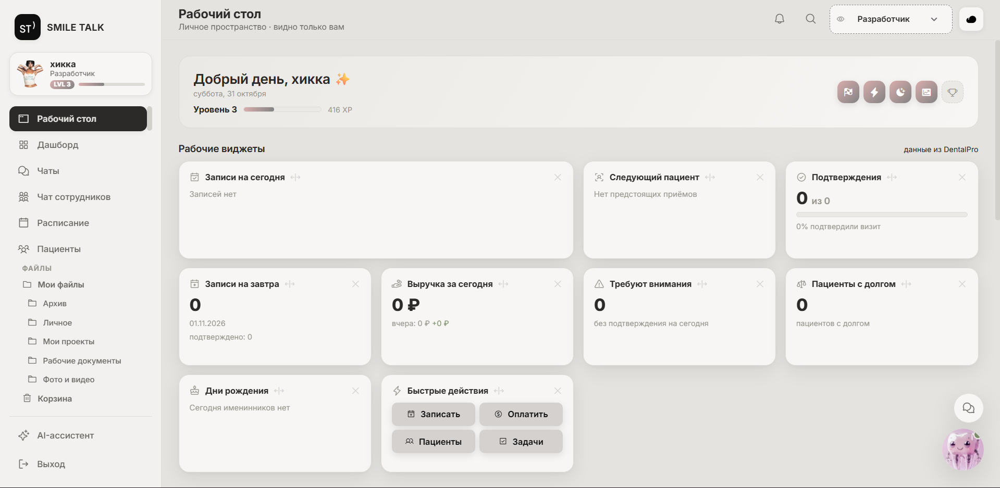
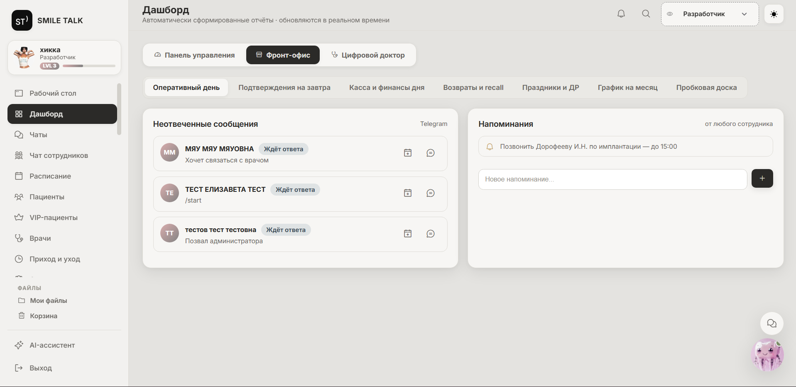
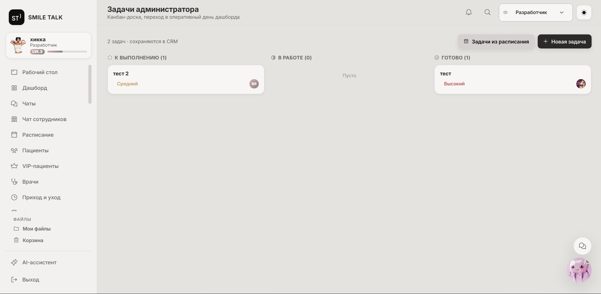
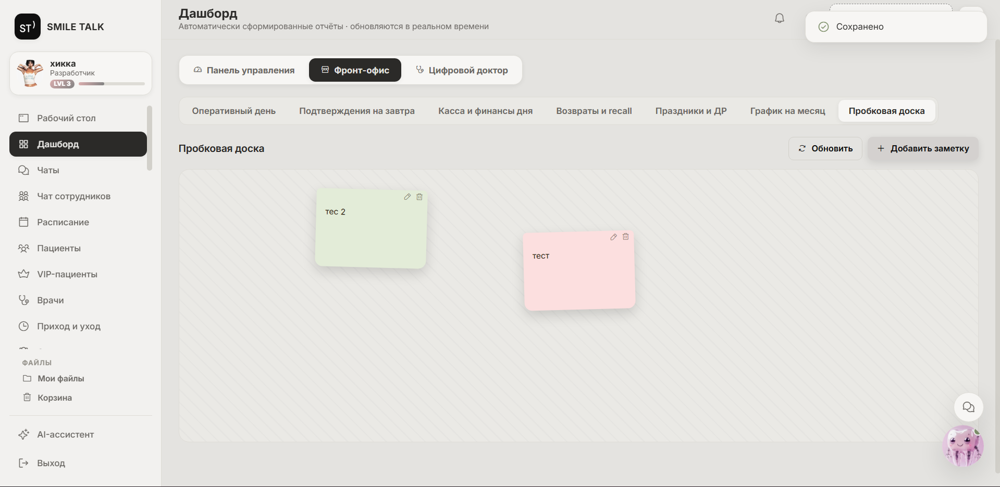
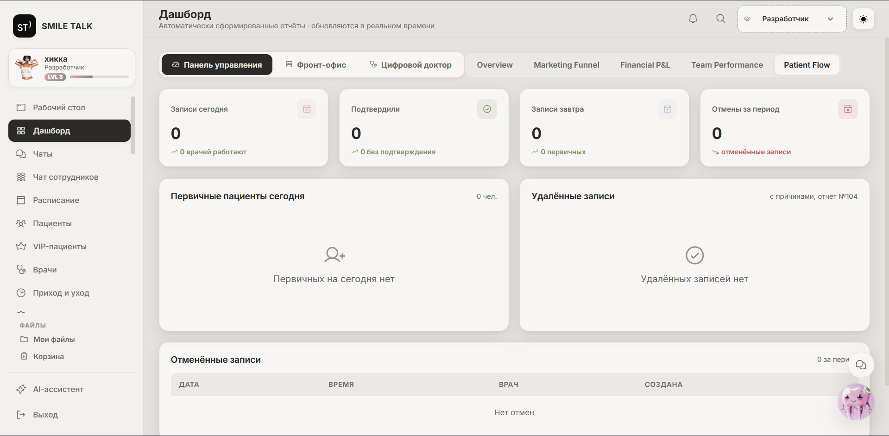

[RU](../../cases/smile-talk.md) / **EN** · [← Profile](../../README.en.md)

# 03 / SMILE TALK

**Clinic workflow automation · CRM + Telegram + AI**

From a clinic administrator's daily tasks to appointments, reminders and automated reporting.

*The project interface, without current clinic data. Other examples below use fictional or test records.*

| | |
|---|---|
| Author | Anastasia Vakulenko / REINOCHKA |
| Role | Product design, coordinating AI-assisted implementation, testing and rollout |
| Introduced | September 2026 |
| Users at rollout | Two administrators, the manager and head physician |
| Publication | Private working project; public case without source code or patient data |

## Problem

Reduce forgotten actions and administrative errors, improve appointment handling, and bring reminders, notes and tasks into one workflow. Management reports were previously assembled manually.

While working as a clinic administrator, I identified needs, designed the solution and coordinated technical implementation with ChatGPT, Claude and OpenAI Codex. I tested the workflows and introduced the system to the team.

## Solution

### Administrator CRM

A workspace with operational widgets, scheduling, patient search, payments, tasks and notes. The interface also includes conversations, appointment summaries, cancellations, rescheduling, reports and feedback. Tasks use To do, In progress and Done states; a shared notes board supports handovers.

### Patient Telegram bot

Patients can book, view their appointment, receive a reminder, cancel or ask a question. Administrators can access conversations in the CRM.

### Administrator Telegram bot

- Morning digest and work reminders.
- An automatic daily summary in the shared chat at **19:30**.
- Notifications about reviews from 2GIS.
- Task-completion buttons that update the CRM.

The daily summary includes planned appointments, actual visits, cancellations, reviews awaiting attention and overdue tasks.

### Dental Pro integration

Automatic two-way exchange between the CRM and the medical information system covers patients, schedules, payment data and related operational information. This description is based on my implementation and operating experience; the public case is not an independent audit of every integration method.

### DeepSeek-based AI agent

Helps administrators retrieve operational information in natural language. For example, “Who is working tomorrow?” returns the doctors and their next-day schedules.

## Three workflows

| Situation | System behavior |
|---|---|
| An administrator must remember an action | The task stays listed; completing it in Telegram updates the CRM |
| Management needs the day's summary | A report arrives in the shared chat at 19:30 |
| An administrator needs tomorrow's doctors' schedule | They ask the AI agent for the schedule |

## Observed outcome

During my employment, I observed fewer forgotten actions and more convenient reporting: an automatic daily summary replaced manual preparation. Error reduction and time savings were not quantitatively measured, so no percentages or financial impact are claimed.

According to information available to me, staff continued using the system after I left. I no longer have access to current clinic data and have not independently verified present operation.

## Interface

The following screens use fictional data, test records or empty states. Zero indicators do not represent measured clinic outcomes. The interface is in Russian.

### Front office

Unanswered messages and reminders together, with fictional demonstration data.

### Administrator tasks

A Kanban board with statuses and priorities, shown with test tasks.

### Shared notes

A shared board for team handovers, shown with test notes.

### Patient flow

Appointments, confirmations and cancellations, without current clinic data.

## Publication boundaries

Some remaining sections open without fresh Dental Pro data or report an unavailable web workspace. Their empty or zero states are not used to assess impact. Source code, internal documentation, working system addresses, real conversations and patient information are not published.

[Discuss a project →](https://t.me/r3in04ka) · [Work with me](../WORK-WITH-ME.md)
